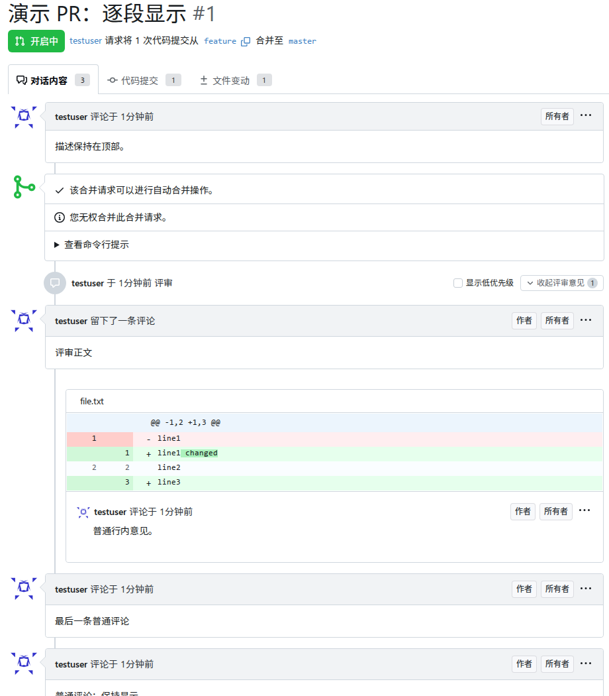
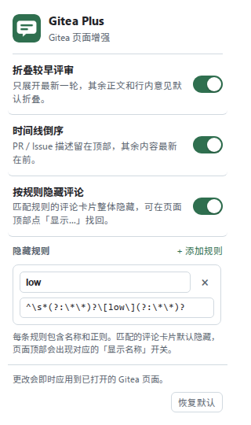

# Gitea Plus

一个 Chrome 扩展，为 Gitea 的 PR / Issue 对话页增加三个能力：

- **折叠较早评审**：只展开最新一轮评审，更早的评审正文和行内意见默认折叠。
- **时间线倒序**：PR / Issue 描述保持在顶部，其余时间线内容按从新到旧展示；合并操作区也参与倒序。
- **按规则隐藏评论**：评论正文匹配任意一条带名称的规则时，整个评论卡片隐藏；页面顶部可按规则名临时显示。
- **设置面板**：点扩展图标即可开关功能、维护规则，修改即时生效并持久保存。

针对实例：<https://git.genarrative.world/git/>





## 功能说明

### 折叠较早评审

- 在 PR 对话页识别每一轮评审，保留评审事件行（评审人、结论、时间）和折叠按钮，隐藏评审正文与行内代码意见。
- 最新一轮默认展开；每一轮都可以手动展开/收起。
- 按钮上的数字是该轮**未隐藏**的行内意见条数；resolved 线程和按规则隐藏的评论都不计入。
- 通过 `#issuecomment-*` 锚点进入时自动展开对应轮次。
- 「最新」按页面中最后一轮**有正文或行内意见**的评审计算；只有结论、没有内容的评审事件不会被当成最新轮。
- 被驳回（dismiss）的评审仍按普通评审参与折叠；单独的驳回事件（灰色徽标）不处理。

### 时间线倒序

- 只处理 PR / Issue 的「对话」页；「代码提交」「文件变动」页不处理。
- PR / Issue 描述始终排在第一位。
- 其余内容（评论、评审、提交事件、状态事件等）按从新到旧排列。
- 合并操作区（检查列表、合并/更新分支按钮等）也参与倒序，开启时排在描述之后；登录提示、分页占位等非时间线元素仍保持在底部。
- 用户手动展开/收起的评审状态不受倒序影响；倒序开关切换时会恢复/重新排列。
- 页面内新发布的评论会出现在顶部（按新增顺序处理）。
- 同一轮评审内部的行内意见仍按文件/行号展示，不单独倒序。

### 按规则隐藏评论

- 在设置面板维护多条规则，每条规则包含一个**名称**和一个 **JavaScript 正则**。
- 评论正文匹配规则时，**整张评论卡片隐藏**：
  - 普通讨论评论、评审正文：整张卡片消失；
  - 行内代码评论：连同文件路径和 diff 预览的整张卡片一起消失。
- 默认规则名称 `low`，正则为 `^\s*(?:\*\*)?\[low\](?:\*\*)?`，可以匹配 `[low]` 和 `**[low]**` 开头的评论（忽略首尾空白）。
- 每条包含隐藏卡片的评审段，会在该段事件行、折叠按钮旁显示「显示<规则名>」复选框；勾选后只显示这一段里该规则命中的卡片；如果该评审原本折叠，会自动展开。取消勾选再次隐藏。
- 不在评审段内的普通评论隐藏时，退回为在对话顶部显示规则复选框。显示状态是临时的，刷新页面后默认隐藏。
- 一条评论命中多条规则时，勾选任意一条即可显示；没有命中的规则不会出现筛选控件。
- 只有实际打开的编辑框会让评论保持可见；Gitea 预渲染的隐藏编辑表单不会阻止整卡隐藏。退出编辑后重新按规则处理。
- PR / Issue 描述、合并操作区不参与规则匹配。
- 正则按 JavaScript `RegExp` 解析；无效或空正则会被跳过并在设置面板提示。
- 正则匹配的是评论渲染后的正文；Gitea 隐藏的原始 Markdown 不会干扰 `^` 锚点。

### 设置面板

点浏览器工具栏的 Gitea Plus 图标：

- 三个开关：「折叠较早评审」「时间线倒序」「按规则隐藏评论」，默认都开启。
- 「按规则隐藏评论」下面维护规则列表：每行有名称和正则，可添加、删除；名称为空时使用「规则 N」。
- 修改通过 `chrome.storage.sync` 保存，立即应用到已打开的 Gitea 页面，无需刷新。
- 「恢复默认」会重置三个开关和默认规则。

## 安装

1. 打开 `chrome://extensions/`。
2. 打开右上角「开发者模式」。
3. 点「加载已解压的扩展程序」，选择本目录（`gitea-plus/`）。
4. 刷新已打开的 Gitea 页面。

如果之前装过旧版 `gitea-review-collapse`，先在 `chrome://extensions/` 移除旧扩展，避免两个扩展同时处理同一页面。

从 0.3.x 升级时，旧的正则会自动迁移成名为 `low` 的规则；重新加载扩展后刷新 Gitea 页面即可。

无需构建步骤，没有后台进程；只申请 `storage` 权限用于保存设置。

## 支持范围与限制

- 只匹配 `https://git.genarrative.world/git/*/*/pulls/*` 和 `https://git.genarrative.world/git/*/*/issues/*`。若用于其他 Gitea 实例，在 `manifest.json` 的 `content_scripts[0].matches` 中加入对应地址即可。
- DOM 选择器按 Gitea 1.26.x 编写；Gitea 大版本升级后若模板结构变化，可能需要同步调整 `src/content.js`。
- 倒序按页面初始 DOM 顺序建立序列；页面内动态新增的内容按“新内容”处理。若 Gitea 以后把“加载更早评论”实现成向前插入，可能需要再补特殊处理。
- 「显示<规则名>」复选框只为当前页面服务，刷新后回到默认隐藏状态；规则本身保存在设置里。
- 同一行内有多个回复时，若卡片包含多条评论，只隐藏命中的单条评论卡片，避免连带隐藏同一张卡片里的其他评论。
- 按钮文字跟随 Gitea 页面语言（`<html lang>`）切换中/英文；设置面板跟随浏览器界面语言。

## 验证环境

- Gitea 1.26.4（本地起同版本实例，构造了 PR 与 Issue：多轮评审、普通评论、`[low]` / `**[low]**` 行内评论、合并区）。
- Chromium 156 / Chrome for Testing 156，扩展以未打包方式加载验证。
- 已覆盖桌面 1280px、移动 390px、浅色与暗色主题。

## 开发与验证

```bash
npm install              # 只用于测试（playwright-core）
npm test                 # DOM 行为测试 + 真实扩展/设置面板测试
npm run test:dom         # 只跑静态 fixture 上的 DOM 行为测试
npm run test:extension   # 只跑扩展加载与 popup 设置测试
npm run test:live        # 可选：在真实 Gitea 页面上校验选择器
```

测试默认使用 `/usr/bin/chromium`，可用 `CHROME_PATH` 指定浏览器。扩展加载测试依赖 `--load-extension` 命令行开关；部分正式版 Chrome 已移除该开关，Chromium 或 Chrome for Testing 可用。

`npm run test:live` 会读取：

- `GP_TEST_URL`：一个已登录/公开可访问的 PR 或 Issue 对话页地址；
- `GP_STORAGE_STATE`：可选，Playwright storage state 文件（需要登录时）；
- `CHROME_PATH`：可选，浏览器路径。

测试覆盖：

- 默认折叠较早轮次、展开最新轮次；
- 单轮展开/收起、锚点自动展开；
- 空评审、仅行内意见的评审、被驳回评审、驳回事件；
- 删除评审内容后的状态清理、resolved 线程计数；
- 时间线倒序、描述置顶、合并区参与倒序、尾部元素保序；
- 按规则隐藏整张普通评论/行内评论卡片、页面「显示名称」筛选；
- 多规则组合、规则改名、规则增删、无效正则、功能关闭；
- 每个评审段独立的「显示名称」筛选、勾选自动展开评审、折叠按钮计数排除隐藏评论；
- 设置即时切换倒序/折叠/规则并恢复原状态；
- PR 与 Issue 页面差异；
- 通过真实 Chromium 加载未打包扩展，验证 manifest、content script、CSS 和 popup 设置写入。

## 文件结构

```
manifest.json          MV3 清单
src/content.js         内容脚本：评审折叠、时间线倒序、规则隐藏、设置同步
src/content.css        折叠按钮、规则筛选与状态样式
popup/                 工具栏设置面板
src/icons/             扩展图标
_locales/              扩展名称与描述的中英文文案
test/dom.test.mjs      DOM 行为测试
test/extension.test.mjs 扩展加载与设置面板测试
test/live.test.mjs     真实页面选择器冒烟测试
test/fixtures/         从 Gitea 1.26.4 页面结构整理的测试夹具
docs/                  README 截图
```
